<p align="center">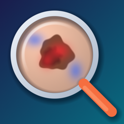</p>

# Spot Check: skin lesion triage that explains itself

> ⚠️ **Student research demo. Not a medical device and not a diagnosis.**

**🎬 [Walkthrough video (71 s)](https://link-coder100788.github.io/skin-lesion/) · 📄 [This writeup as a PDF](docs/writeup.pdf) · 📱 [iPhone app](ios/README.md) · 🧪 [Plan](PLAN.md)**

Upload a dermoscopy photo of a skin spot. Spot Check tells you whether to see a doctor soon,
shows **which parts of the image drove that call** (image SHAP, with Grad-CAM alongside),
shows **how age, sex and body site moved the score**, and **refuses to give a verdict** on
images that look unlike its training data. It runs as a Gradio web app and as a SwiftUI
iPhone app that does everything on the phone.

### TL;DR
- **Model:** FastViT-T12 [10] at 384 px, trained on HAM10000 [1] plus 15,316 ISIC 2019 images [2, 3],
  chosen from six architectures on validation only.
- **Locked test set** (1,503 images of unseen lesions): urgent AUROC **0.93**, balanced accuracy
  **0.82** (up from 0.66 for our first model), specificity **0.87**.
- **Missed target:** the threshold set for 90% sensitivity on validation caught **80%** of urgent
  cases on test. We report this as is and explain why (§5).
- **Explanations, tested rather than trusted:** SHAP is faithful (deletion test), puts 82% of its mass
  on melanomas inside the lesion, and shows no sign of a dark-corner shortcut. The maps are only
  moderately stable.
- **Fairness:** on clinical photos, false alarms rise steeply with darker skin (specificity 0.63 → 0.36).
- **Safety:** an out-of-distribution guard turned away 19 of 22 non-skin images. The app never says
  "you are fine".
- **On device:** the iPhone app runs the CNN in Core ML, with a hand-written gradient so that Grad-CAM
  works live. The OOD guard, the metadata model and the image SHAP are ported to Swift, and the app
  is tested for parity against the Python pipeline.

<p align="center">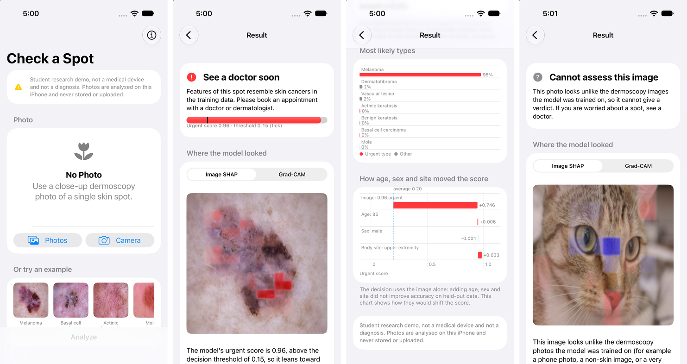</p>
<p align="center"><sub>The iPhone app: home · a melanoma flagged with its SHAP map · class probabilities and metadata waterfall · a cat photo refused as "cannot assess".</sub></p>

<p align="center"><a href="https://link-coder100788.github.io/skin-lesion/">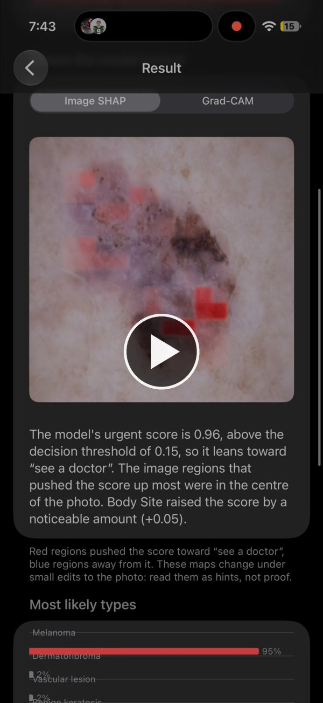</a></p>
<p align="center"><sub>▶ <a href="https://link-coder100788.github.io/skin-lesion/">Walkthrough video</a> (71 s, recorded on an iPhone): picking an example, the verdict with its SHAP map and summary, and a photo the app refuses to assess.</sub></p>

---

## 1. The problem

Melanoma caught early has a five-year survival of about 99%. Once it has spread, that number is far
lower [22]. Dermatology waiting lists are long, so a tool that helps decide *who should be seen
first* could matter, but only if people can trust it. A bare score isn't enough. Trust needs
reasons ("what did the model look at?") and honest limits ("when should I ignore it?").

We frame the task as **triage**, not diagnosis. Each image is either **"see a doctor soon"** (the
melanoma, basal cell carcinoma and actinic keratosis / intraepithelial carcinoma classes, together
called "urgent") or **"lower concern"**. A third outcome, **"cannot assess"**, is for images the
model shouldn't judge. In triage, missing a cancer costs more than a false alarm, so we fix the
operating point for ≥ 90% sensitivity and then try to keep specificity as high as possible.

## 2. What we built

```
photo ──► resize 384 px ──► FastViT-T12 ──► temperature scaling ──► p_urgent ≥ τ ? ──► triage
                               │                                       │
                               ├─► embedding ──► OOD guard ────────────┴─► "cannot assess"
                               │
       age, sex, site ─────────┴─► XGBoost fusion ──► grouped metadata SHAP (explanation only)
       image SHAP (Partition / Owen values, blur masker) + Grad-CAM ──► "where the model looked"
```

| Layer | What the user sees | How |
|---|---|---|
| Triage | "See a doctor soon" / "Lower concern" | Calibrated urgent score vs. threshold τ = 0.150 |
| Where it looked | Red/blue map over the photo | Image SHAP [4] (Owen values [17], blur masker); Grad-CAM [5] as a cross-check |
| Why, in numbers | Waterfall: base → image → age → sex → site | Exact Shapley values over 4 feature groups of the XGBoost [12] fusion model |
| When not to trust it | "Cannot assess this image" | kNN [7] + Mahalanobis [8] distance on the CNN embedding; low-confidence badge from max-softmax [9] |
| Plain words | One-paragraph summary | Deterministic template from the SHAP map and the largest metadata effect (no LLM) |

## 3. Data

| Dataset | Use | Size |
|---|---|---|
| **HAM10000** [1] (dermoscopy, 7 classes) | train / val / test | 10,015 images of 7,470 lesions |
| **ISIC 2019** [2, 3] (dermoscopy; HAM10000 duplicates removed, SCC → akiec) | extra *training* images only | +15,316 |
| **HAM10000 lesion masks** [1] | shortcut hunt (SHAP mass inside the lesion) | 10,015 masks |
| **Fitzpatrick17k** [6] (clinical photos, skin types I–VI) | fairness audit | 1,860 images in matching classes |

- **Lesion-grouped split.** HAM10000 has several photos of the same lesion, so we split by
  `lesion_id` (StratifiedGroupKFold, seed 42): 7,009 train / 1,503 val / 1,503 test images, with
  no lesion in two splits. A random image split leaks lesions and inflates scores.
- **Imbalance.** Moles are 67% of HAM10000 (6,705 of 10,015), so "always predict mole" scores 67%
  accuracy and catches 0% of cancers. We never report plain accuracy. We use balanced accuracy,
  urgent sensitivity/specificity and AUROC instead.
- Validation and test are always HAM10000. ISIC 2019 only adds training images, so the numbers stay comparable.

<p align="center">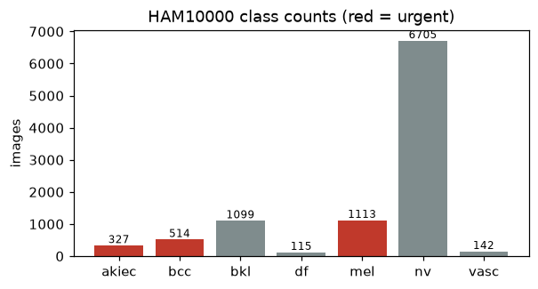 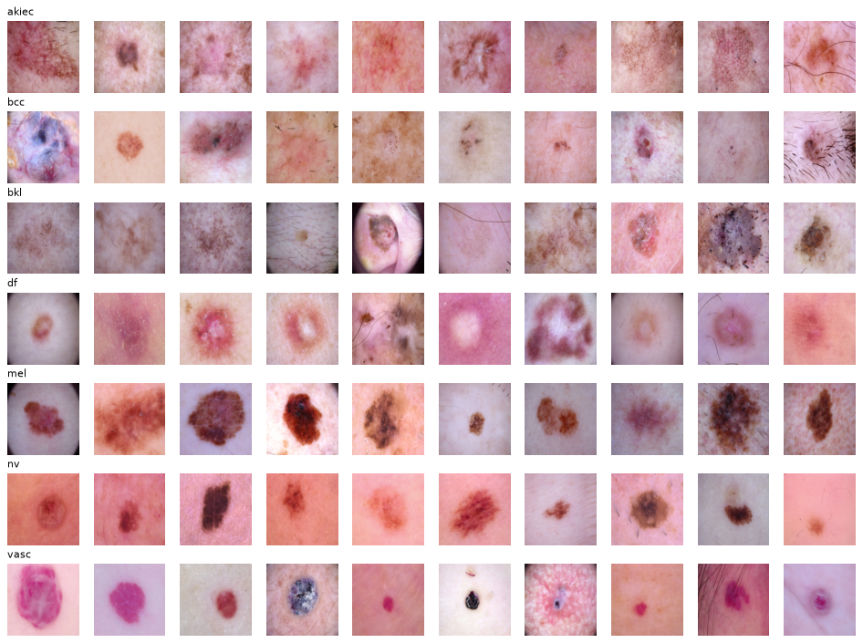</p>

## 4. Method

### 4.1 Training recipe
A timm [23] backbone with ImageNet weights. The classifier head trains for 2 epochs, then the full
network fine-tunes with AdamW (1e-4 backbone / 3e-4 head) on a one-cycle cosine schedule.
Regularisation is label smoothing 0.1 [19] and stochastic depth 0.2 [20], with weighted
cross-entropy (`w = 1/√freq`) and AMP. The checkpoint is chosen on **validation balanced
accuracy**. All training ran as private Kaggle GPU kernels (`kaggle/build_kernel.py`).

### 4.2 Choosing the model (validation only)
Our first EfficientNet-B0 [11] reached 0.676 validation balanced accuracy. A regularisation sweep
(label smoothing + stochastic depth) moved it only to 0.701, so we compared architectures under
one shared recipe (224 px, 20 epochs):

| Backbone (224 px, HAM10000 only) | Val. balanced acc. | Val. urgent AUROC | Specificity @ 90% sens. |
|---|---|---|---|
| **FastViT-T12** [10] | **0.786** | **0.931** | **0.79** |
| ConvNeXt V2-Femto [21] | 0.760 | 0.925 | 0.78 |
| FastViT-S12 [10] | 0.746 | 0.925 | 0.78 |
| EfficientNetV2-B0 [21] | 0.733 | 0.904 | 0.67 |
| EfficientNet-B0 [11] | 0.701 | 0.894 | 0.70 |
| MobileNetV4-Hybrid-M [21] | 0.353 | 0.837 | 0.63 (did not converge with this recipe) |

We then retrained the winner at **384 px for 2 + 30 epochs on HAM10000 + ISIC 2019** (22,325
training images, 2.9 h on a Kaggle GPU). This reached **0.832** validation balanced accuracy,
**0.948** urgent AUROC and **0.89** specificity at 90% sensitivity. The test set was not used to choose anything.

<p align="center">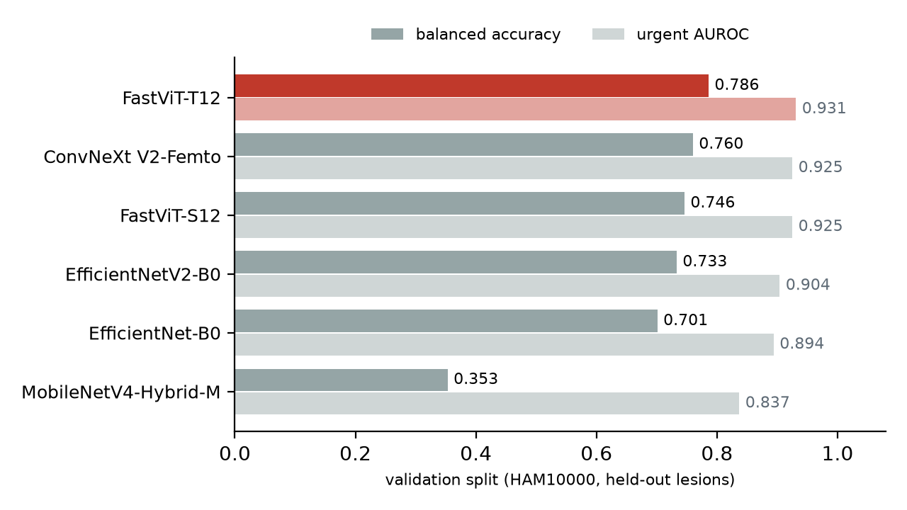</p>

### 4.3 Calibration, threshold, fusion
- **Temperature scaling** [13] (one scalar T fit on validation, T = 0.66), so that a score of 0.8 means roughly 80%.
- **Threshold τ = 0.150:** the highest threshold that keeps validation urgent sensitivity ≥ 0.90.
- **Metadata fusion:** XGBoost on the calibrated CNN probabilities plus age, sex and site, trained
  only on validation-split outputs (images the CNN never trained on) with lesion-grouped 5-fold CV.
  The rule fixed in advance was to deploy it only if it beat the CNN on validation. It did not
  (urgent AUROC 0.957 vs 0.948, but specificity at 90% sensitivity 0.85 vs 0.89), so **the CNN
  makes the decision** and fusion is kept to *explain* how metadata shifts the score.

### 4.4 Explanations
- **Image SHAP:** shap's Partition explainer [4], which computes Owen values [17] over a recursive
  split of the image. Hidden regions are replaced with a blurred image (box blur 110 px at 384 px)
  and the explained output is the calibrated p_urgent. That gives a signed map, where red pushes
  toward "see a doctor" and blue away from it.
- **Grad-CAM** [5] on the last feature stage, as an independent cross-check.
- **Metadata SHAP:** exact Shapley values over four patient-recognisable groups (image, age, sex,
  site), in probability units, so base + contributions = p_urgent exactly.

### 4.5 Out-of-distribution guard
An image is "unlike training" if its **kNN cosine distance** [7] (10th neighbour among 7,009
training embeddings) **or** its **Mahalanobis distance** [8] (Ledoit-Wolf shared covariance [18],
nearest class mean) exceeds the 99th percentile seen on validation. Such images get "cannot
assess", never a verdict. A low max-softmax [9] adds a "not confident" badge.

## 5. Results (locked HAM10000 test set, 1,503 images, unseen lesions)

T, τ and the fusion decision were all fixed on validation before the test set was scored. The
test set was scored once for the first model and once for the final model, never during the
sweep. The brackets are 95% CIs from 1,000 bootstrap resamples.

| Model | Urgent sensitivity @ τ | Specificity | AUROC (urgent) | Balanced acc. (7-class) |
|---|---|---|---|---|
| A · always "nevus" | 0.00 | 1.00 | 0.50 | 0.14 |
| B · metadata-only logistic regression | 0.92 [0.89, 0.95] | 0.37 [0.34, 0.40] | 0.77 | 0.38 |
| **FastViT-T12, calibrated (deployed)** | **0.80 [0.76, 0.85]** | **0.87 [0.85, 0.89]** | **0.93 [0.91, 0.95]** | **0.82 [0.80, 0.85]** |
| FastViT-T12 + metadata (XGBoost fusion) | 0.90 [0.86, 0.93] | 0.82 [0.79, 0.84] | 0.94 | 0.82 |
| *First model: EfficientNet-B0, calibrated* | *0.93 [0.90, 0.96]* | *0.72 [0.69, 0.74]* | *0.90* | *0.66* |

- **Better ranking:** AUROC 0.90 → 0.93 and balanced accuracy 0.66 → 0.82. Published HAM10000 /
  ISIC 2018 systems reach a mean recall of about 0.75–0.88 [16], and ours sits inside that range.
  Per-class recall: akiec 0.59, bcc 0.77, bkl 0.87, df 1.00, mel 0.64, nv 0.89, vasc 1.00.
- **Calibration:** temperature scaling cuts the test calibration error (ECE) from 0.129 to 0.054.
- **⚠ The 90% sensitivity target was missed (0.80 on test).** Validation picked the architecture,
  the checkpoint epoch, T and τ. With that many choices made on it, the validation curve was
  optimistic, and the threshold sat right at its edge. We did **not** move τ, or switch to fusion
  (which happened to land at 0.90), after seeing the test result: either would make the test set
  a second validation set. The fix is a separate calibration split for τ (§9).
- **Fusion stays a null result.** It wasn't better on validation, so it isn't deployed, whatever the test set says.

<p align="center">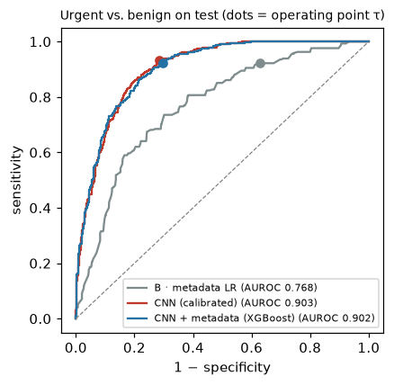 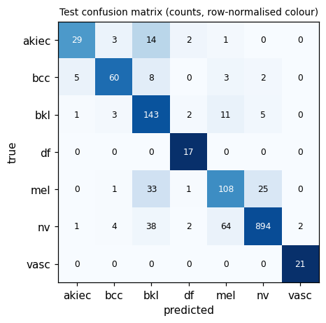 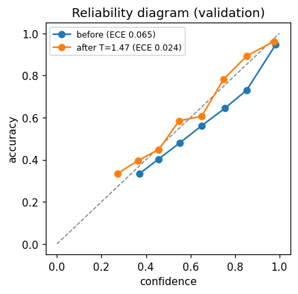</p>

## 6. Did the explanations hold up? (notebook 05)

We treated the SHAP maps as claims to test, not as pictures to trust.

- **Shortcut hunt.** Dark vignette corners appear in 10% of melanomas but only 2% of moles, which is
  a possible shortcut (ink markings fooled a commercial CNN in [15]). On flagged images, SHAP puts a
  median **1.4%** of its positive mass in the corners, which cover 3.9% of the image. **We found no
  evidence that the model uses them.**
- **Lesion-focused.** For melanomas, **82%** of positive SHAP mass falls inside the lesion mask,
  which covers 34% of the image. For our first model the figure was 40%.
- **Faithful.** Deleting the top-SHAP pixels first lowers the urgent score much faster than random
  deletion (deletion AUC **0.26** vs 0.58; Grad-CAM 0.34).
- **Moderately stable.** A map is deterministic for a fixed input. Rank correlation with the
  original map is 0.69 after a mirror flip and 0.39 after faint noise, and SHAP vs. Grad-CAM agree
  at 0.35. The first model's maps were far less stable (0.14 / 0.05 / 0.01). The maps are
  **hints, not proof**, and the app says so.
- **Metadata matters little.** Mean |contribution| to p_urgent: image 0.25, body site 0.023, age 0.013, sex 0.002.

<p align="center">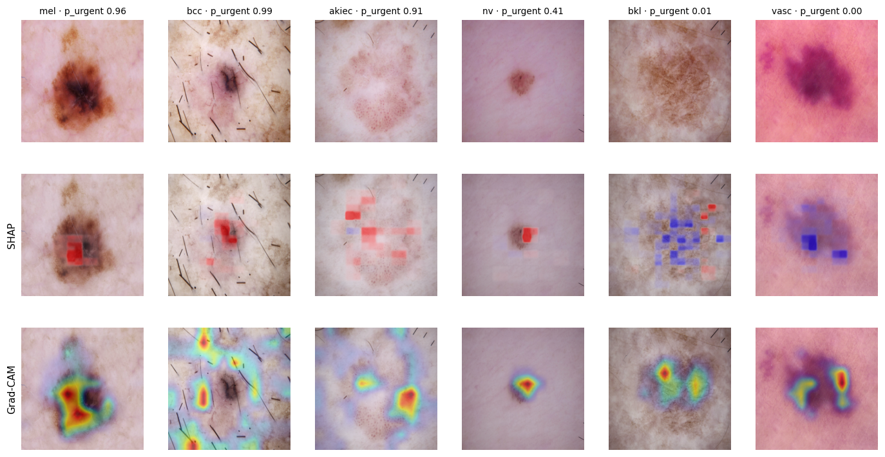 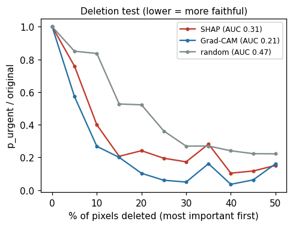</p>
<p align="center">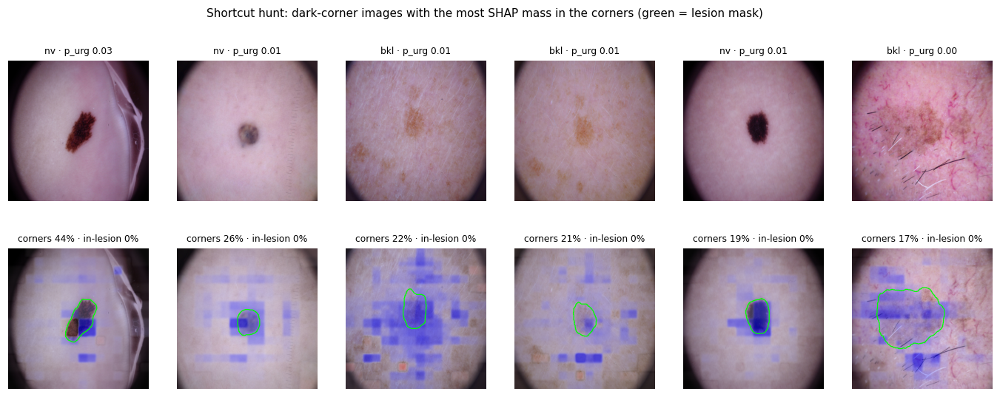</p>

## 7. Fairness and safety (notebooks 04, 06)

| Data (same model, same τ) | Urgent sensitivity | Specificity | n urgent | Flagged as OOD |
|---|---|---|---|---|
| HAM10000 test (dermoscopy) | 0.80 [0.76, 0.84] | 0.87 | 295 | – |
| Fitzpatrick17k types I–II (clinical photos) | 0.71 [0.68, 0.75] | 0.63 | 783 | 40% |
| Fitzpatrick17k types III–IV | 0.69 [0.65, 0.73] | 0.49 | 422 | 38% |
| Fitzpatrick17k types V–VI | 0.77 [0.68, 0.86] | 0.36 | 92 | 30% |

- On clinical photos, sensitivity drops for every skin type, and **specificity falls steeply with
  darker skin** (0.63 → 0.36). In practice, people with darker skin would get many more false alarms.
- Two shifts are mixed here: photo type (clinical vs. dermoscopy) and skin tone. HAM10000 has no
  skin-type labels and very little dark skin, so we can't separate them. The fix is diverse
  *dermoscopic* data such as DDI [14].
- **OOD guard:** 1.5% of real validation images are flagged. It flagged **10/12** non-skin
  development images (it missed a photo of a man with a camera and a Hubble star field) and
  **9/10** unseen ones (it missed a histology slide). That's 19/22 overall, so the guard is not a
  guarantee. Without it, the cat photo would have been called "urgent" with a score of 0.91.

<p align="center">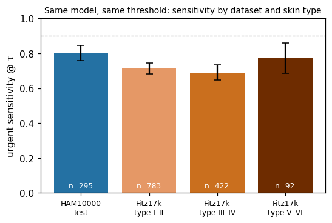 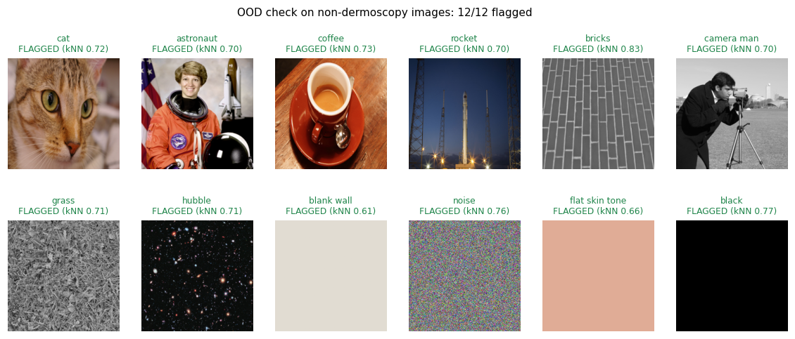</p>

## 8. The iPhone app (`ios/`)

A native SwiftUI app (iOS 18+). **No server, no Python: photos never leave the phone.**

| Piece | On device |
|---|---|
| FastViT-T12 @ 384 px | Core ML, converted from the PyTorch checkpoint with coremltools |
| Calibration, τ, triage text, OOD guard | Swift + Accelerate (BLAS kNN over 7,009 embeddings, Mahalanobis) |
| XGBoost fusion + exact metadata SHAP | A small Swift tree evaluator (1,400 trees) |
| Image SHAP | Our Swift port of the Owen-value partition explainer with the same blur masker (300 evaluations) |
| Grad-CAM | Live, inside the Core ML model. Core ML can't backpropagate, so we wrote the gradient of p_urgent back to the last feature stage by hand as forward ops (through the reparameterised MobileOne conv, squeeze-excite, GELU, pooling and classifier). It matches autograd to 5e-6 relative error |

**Parity tests** (`ios/VeritasTests`, run on the simulator) check the phone against the Python pipeline:
- the triage and OOD decisions are identical, and p_urgent is within 0.02, on all 18 fixtures (9 images × with/without metadata);
- the XGBoost probabilities and metadata SHAP match to within 1e-4;
- Grad-CAM matches pytorch-grad-cam on every example (correlation 1.000);
- the image SHAP map sums to f(image) − f(blurred) (Owen efficiency) and agrees with Python's 2,000-evaluation map (r = 0.64 on a 16×16 grid);
- the non-skin photo is refused.

The UI follows native iOS conventions. A form takes the photo (library or camera) and the optional
age, sex and site, and offers 9 examples (8 test-set lesions and a cat). The result screen shows a
verdict card with the score and threshold, a SHAP / Grad-CAM switch, the summary, a probability
chart and the metadata waterfall (Swift Charts). An About sheet works as a model card with the
test metrics and known limits. The app icon (a dermoscope lens over a spot with a SHAP-style
red/blue glow) is generated by `ios/make_icon.py`.

A 71-second screen recording of the app on an iPhone is on [GitHub Pages](https://link-coder100788.github.io/skin-lesion/) (file: `docs/walkthrough.mp4`).

## 9. Limitations and next steps

- **Validation did too many jobs.** It picked the architecture, the epoch, T and τ. Next time:
  train / model-selection / **calibration** / test splits, so τ is set on data nothing else touched.
- **Not a clinical validation.** It's a retrospective, single-source test set (HAM10000 comes from
  two sites) with no prospective testing and no clinician study.
- **Skin tone.** We need dermoscopy across all Fitzpatrick types (e.g. DDI [14]), then a re-run of the audit.
- **Shortcut-proofing.** Crop to the lesion, add artifact augmentation, retrain and repeat the shortcut hunt.
  Ink and ruler artifacts are *not* auto-flagged: colour thresholds confused ink with blue-purple pigment.
- **The OOD design was chosen after Mahalanobis alone failed** on the development non-skin images,
  which is why we report a second, unseen set.
- **Uncertainty:** ensembles or MC-dropout, shown as a confidence band. **Test-time augmentation**
  and a model-randomisation sanity check for the maps were not done.

## 10. Reproduce

```bash
python3 -m venv .venv && .venv/bin/pip install -r requirements.txt
brew install libomp xcodegen      # OpenMP for xgboost on macOS; xcodegen for the iOS project
```

**Data** (Kaggle API; put `KAGGLE_TOKEN=...` in `.env`):
```bash
set -a; . ./.env; set +a; export KAGGLE_API_TOKEN="$KAGGLE_TOKEN"
.venv/bin/kaggle datasets download kmader/skin-cancer-mnist-ham10000 -p data/ham --unzip
.venv/bin/kaggle datasets download tschandl/ham10000-lesion-segmentations -p data/masks --unzip
.venv/bin/kaggle datasets download -f fitzpatrick17k.csv asosenge/fitzpatrick17k -p data/fitz
```
The training kernels attach `cdeotte/jpeg-isic2019-512x512` (ISIC 2019) and the Fitzpatrick17k
images on Kaggle directly, so they are not downloaded locally.

**Pipeline** (heavy steps run as private Kaggle GPU kernels):
```bash
notebooks/run.sh 01 02                                          # EDA + baselines (local, CPU)
.venv/bin/python kaggle/build_kernel.py sweep --sweep final --user <you>   # bundle src/ into a kernel
.venv/bin/kaggle kernels push -p kaggle/build/sweep-final       # train FastViT-T12 @ 384 px (~3 h GPU)
.venv/bin/python kaggle/build_kernel.py explain --user <you> --from-sweep final/fastvit_t12_384
                                                                # notebooks 03–06 + app examples (~2 h)
.venv/bin/kaggle kernels push -p kaggle/build/explain
.venv/bin/kaggle kernels output <you>/skin-lesion-triage-explain -p kaggle/out/explain
# copy kaggle/out/explain/proj/{models,results,figures,notebooks,app/examples} into the repo
```
`models/cnn.pt`, `models/outputs.npz` and `models/ood.npz` are git-ignored (they're large), so they come from the kernel output.

**Web demo:** `.venv/bin/python app/app.py` → http://127.0.0.1:7860.

**iPhone app:** `.venv/bin/python ios/export_assets.py && cd ios && xcodegen && open Veritas.xcodeproj`,
then pick a simulator, or your iPhone with a signing team. See [ios/README.md](ios/README.md).

**Writeup PDF:** `docs/build_pdfs.sh` renders this README to `docs/writeup.pdf` (mistune + headless Chrome).
A pitch deck can be generated with `.venv/bin/python slides/build_slides.py` (`slides/pitch.pptx`, numbers read from `results/`).

## 11. Repo layout
```
src/        data.py (lesion-grouped split, transforms, ISIC 2019 mapping) · model.py (timm, temperature scaling)
            train.py · fusion.py · explain.py (SHAP, Grad-CAM, checks) · triage.py (pipeline,
            OOD guard, summary text) · metrics.py · artifacts.py (dark-corner / hair flags)
notebooks/  01_eda · 02_baselines · 03_train_cnn · 04_calibrate_fusion · 05_explain_shap ·
            06_eval_fairness   (.py = source, .ipynb = executed)
kaggle/     build_kernel.py (train / sweep / explain kernels) · compare_sweeps.py
app/        app.py (Gradio web demo) · build_examples.py · examples/
ios/        SwiftUI iPhone app · export_assets.py (Core ML + assets) · make_icon.py · parity tests
docs/       writeup.pdf · build_pdfs.sh · build_writeup.py · app icon, screenshots, walkthrough video
splits/     split.csv (70/15/15, StratifiedGroupKFold by lesion_id, seed 42)
models/     config.json (T, τ, OOD thresholds) · xgb.json · fusion_background.csv · train_log.json
results/ figures/ slides/
```

## 12. Tools
- **Python** (`.venv`, pinned in `requirements.txt`): torch, torchvision, timm, scikit-learn,
  xgboost, shap, grad-cam, numpy, pandas, scipy, scikit-image, opencv-python-headless, pillow,
  matplotlib, gradio, python-pptx, jupytext / nbconvert / nbclient / ipykernel, kaggle, coremltools, mistune.
- **Swift:** SwiftUI, Core ML, Accelerate, Swift Charts, PhotosUI, XCTest.
- **Other:** Kaggle GPU kernels for all training and SHAP runs; Homebrew `libomp` and `xcodegen`;
  headless Chrome (already installed) for the PDF.
- **macOS note:** torch and xgboost each bundle libomp, and multithreaded OpenMP then segfaults,
  so `src/__init__.py` sets `OMP_NUM_THREADS=1` on macOS.

## References

1. P. Tschandl, C. Rosendahl, H. Kittler. *The HAM10000 dataset, a large collection of multi-source dermatoscopic images of common pigmented skin lesions.* Scientific Data 5, 180161 (2018). [doi:10.1038/sdata.2018.161](https://doi.org/10.1038/sdata.2018.161). CC BY-NC-SA 4.0; the example images in `app/examples/` come from it.
2. M. Combalia et al. *BCN20000: Dermoscopic lesions in the wild.* arXiv:1908.02288 (2019). [arxiv.org/abs/1908.02288](https://arxiv.org/abs/1908.02288)
3. N. Codella et al. *Skin lesion analysis toward melanoma detection: a challenge at ISBI 2017 (ISIC).* ISBI 2018. [arxiv.org/abs/1710.05006](https://arxiv.org/abs/1710.05006). ISIC 2019 challenge: [challenge.isic-archive.com/landing/2019](https://challenge.isic-archive.com/landing/2019/)
4. S. M. Lundberg, S.-I. Lee. *A unified approach to interpreting model predictions (SHAP).* NeurIPS 2017. [arxiv.org/abs/1705.07874](https://arxiv.org/abs/1705.07874)
5. R. R. Selvaraju et al. *Grad-CAM: Visual explanations from deep networks via gradient-based localization.* ICCV 2017. [arxiv.org/abs/1610.02391](https://arxiv.org/abs/1610.02391)
6. M. Groh et al. *Evaluating deep neural networks trained on clinical images in dermatology with the Fitzpatrick 17k dataset.* CVPR Workshops 2021. [arxiv.org/abs/2104.09957](https://arxiv.org/abs/2104.09957)
7. Y. Sun, Y. Ming, X. Zhu, Y. Li. *Out-of-distribution detection with deep nearest neighbors.* ICML 2022. [arxiv.org/abs/2204.06507](https://arxiv.org/abs/2204.06507)
8. K. Lee, K. Lee, H. Lee, J. Shin. *A simple unified framework for detecting out-of-distribution samples and adversarial attacks.* NeurIPS 2018. [arxiv.org/abs/1807.03888](https://arxiv.org/abs/1807.03888)
9. D. Hendrycks, K. Gimpel. *A baseline for detecting misclassified and out-of-distribution examples in neural networks.* ICLR 2017. [arxiv.org/abs/1610.02136](https://arxiv.org/abs/1610.02136)
10. P. K. A. Vasu et al. *FastViT: A fast hybrid vision transformer using structural reparameterization.* ICCV 2023. [arxiv.org/abs/2303.14189](https://arxiv.org/abs/2303.14189)
11. M. Tan, Q. V. Le. *EfficientNet: Rethinking model scaling for convolutional neural networks.* ICML 2019. [arxiv.org/abs/1905.11946](https://arxiv.org/abs/1905.11946)
12. T. Chen, C. Guestrin. *XGBoost: A scalable tree boosting system.* KDD 2016. [arxiv.org/abs/1603.02754](https://arxiv.org/abs/1603.02754)
13. C. Guo, G. Pleiss, Y. Sun, K. Q. Weinberger. *On calibration of modern neural networks.* ICML 2017. [arxiv.org/abs/1706.04599](https://arxiv.org/abs/1706.04599)
14. R. Daneshjou et al. *Disparities in dermatology AI performance on a diverse, curated clinical image set (DDI).* Science Advances 8(32) (2022). [doi:10.1126/sciadv.abq6147](https://doi.org/10.1126/sciadv.abq6147)
15. J. K. Winkler et al. *Association between surgical skin markings in dermoscopic images and diagnostic performance of a deep learning convolutional neural network for melanoma recognition.* JAMA Dermatology 155(10) (2019). [doi:10.1001/jamadermatol.2019.1735](https://doi.org/10.1001/jamadermatol.2019.1735)
16. P. Tschandl et al. *Comparison of the accuracy of human readers versus machine-learning algorithms for pigmented skin lesion classification: an open, web-based, international, diagnostic study.* Lancet Oncology 20(7) (2019). [doi:10.1016/S1470-2045(19)30333-X](https://doi.org/10.1016/S1470-2045(19)30333-X)
17. G. Owen. *Values of games with a priori unions.* In: Mathematical Economics and Game Theory, Springer (1977). [doi:10.1007/978-3-642-45494-3_7](https://doi.org/10.1007/978-3-642-45494-3_7)
18. O. Ledoit, M. Wolf. *A well-conditioned estimator for large-dimensional covariance matrices.* J. Multivariate Analysis 88(2) (2004). [doi:10.1016/S0047-259X(03)00096-4](https://doi.org/10.1016/S0047-259X(03)00096-4)
19. C. Szegedy et al. *Rethinking the Inception architecture for computer vision (label smoothing).* CVPR 2016. [arxiv.org/abs/1512.00567](https://arxiv.org/abs/1512.00567)
20. G. Huang et al. *Deep networks with stochastic depth.* ECCV 2016. [arxiv.org/abs/1603.09382](https://arxiv.org/abs/1603.09382)
21. Other backbones compared: S. Woo et al. *ConvNeXt V2* (CVPR 2023, [arXiv:2301.00808](https://arxiv.org/abs/2301.00808)); M. Tan, Q. V. Le. *EfficientNetV2* (ICML 2021, [arXiv:2104.00298](https://arxiv.org/abs/2104.00298)); D. Qin et al. *MobileNetV4* (ECCV 2024, [arXiv:2404.10518](https://arxiv.org/abs/2404.10518)).
22. American Cancer Society. *Survival rates for melanoma skin cancer.* [cancer.org](https://www.cancer.org/cancer/types/melanoma-skin-cancer/detection-diagnosis-staging/survival-rates-for-melanoma-skin-cancer-by-stage.html)
23. R. Wightman. *PyTorch Image Models (timm).* [github.com/huggingface/pytorch-image-models](https://github.com/huggingface/pytorch-image-models)
